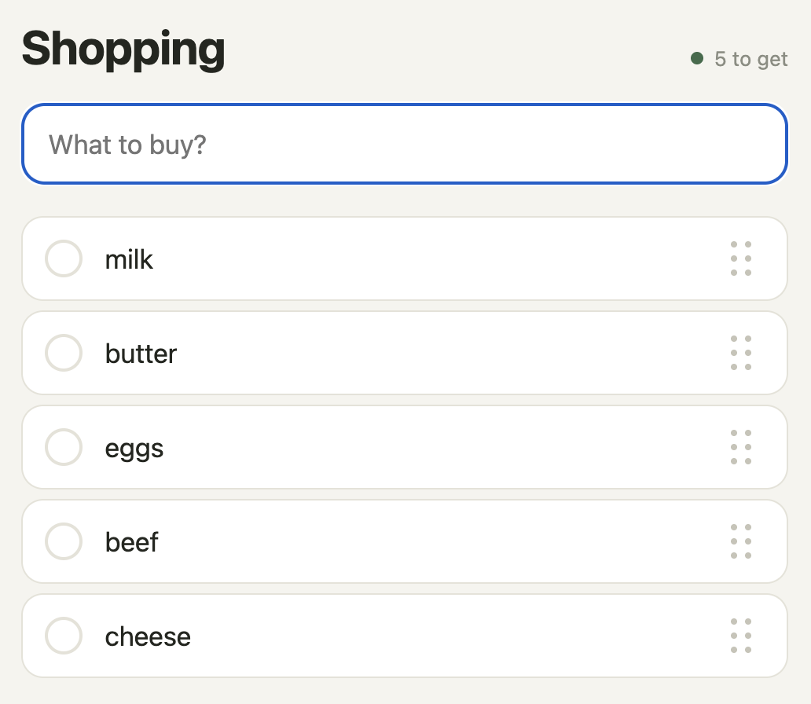

# shopping-list

A shared shopping list hosted here:
https://shopping-list.val.run/

## Why it exists

On a catamaran trip around Sardinia with friends, we needed one shopping list for the boat that
everyone could add to and then tick off while shopping. No logging in, no accounts, and changes
had to reach the other phones quickly. It just had to work.

The app took half an hour, deployment and fixes included.

## Using it

Open the page and create a list, then send the link to the people you shop with. Anyone with the
link adds items and ticks them off, and the other phones show the change within a couple of
seconds. Holding an item lets you rename it; clearing the name deletes it. The dots on the right
of each row are for dragging it to a new position. A list nobody opens for 14 days is deleted.
The interface follows the browser language: Polish or English (add `?lang=pl` or `?lang=en`
to force one).

## How it works

The whole app is one TypeScript file, `main.ts`, running as an HTTP val on Val Town with its
built-in SQLite. The page is plain JavaScript and CSS in the same file, with no framework and no
build step.

- Access comes from the link itself. `POST /api/new` returns a random 10-character list id, and
  anyone who has `/l/<id>` can read and edit that list.
- While the page is visible, each phone polls the server every 2 seconds: it sends its own
  changes and receives everything newer than what it already has.
- Two people can change the same item at the same moment. Each field of an item (name, position,
  checked, deleted) keeps its own timestamp and device id, and the newer write wins field by
  field, so ticking an item off on one phone and renaming it on another don't overwrite each
  other. A deleted item stays in the database as a tombstone, so a phone that was offline cannot
  bring it back.
- There is no scheduled cleanup. An expired list is deleted when someone opens its link, and all
  expired lists are removed whenever a new list is created and on a random 2% of requests.

## Running your own copy

Create an HTTP val on Val Town and paste `main.ts`. The code uses Val Town's `std/sqlite`, so on
any other platform you would have to replace that import.

## Privacy

What the app stores and for how long: [PRIVACY.md](PRIVACY.md).

## License

[MIT](LICENSE)

## Limits

Anyone with the link has full access to the list. `/api/new` has no rate limit, and there is no
backup.
